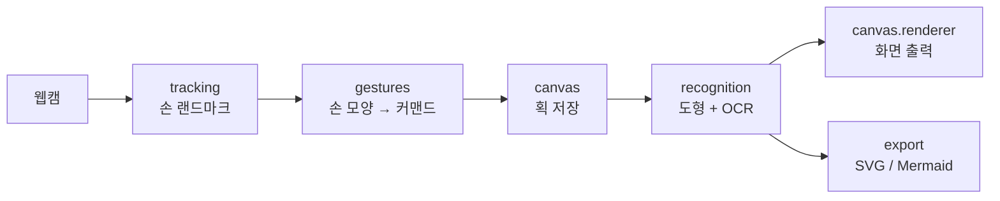

# Air Canvas ✋🖊️

> 손동작으로 그리는 AI 스마트 화이트보드 (Gesture-to-Image / Code Canvas)

키보드나 마우스 없이, 허공에서 손가락으로 그린 그림과 글씨를 AI가 인식해
**깨끗한 디지털 도형, 텍스트, 다이어그램 코드(Mermaid)** 로 바꿔주는 인터랙티브 도구입니다.

<!-- 데모 GIF가 준비되면 아래 주석을 해제하세요 -->
<!--  -->

## 주요 기능

- **에어 드로잉**: 검지 끝을 펜처럼 써서 허공에 그리기 (MediaPipe Hands)
- **제스처 커맨드**: 손 모양만으로 그리기, 지우기, 색 변경, 인식, 저장
- **실시간 도형 보정**: 손으로 그린 사각형/원/삼각형/선을 깨끗한 도형으로 변환
- **손글씨 인식**: Hugging Face OCR 모델로 공중에 쓴 글씨를 텍스트로 변환
- **Code Canvas**: 그린 박스와 화살표를 Mermaid flowchart 코드로 내보내기

## 제스처

| 손 모양 | 동작 |
|---|---|
| ☝️ 검지만 펴기 | 그리기 |
| ✌️ 검지 + 중지 | 펜 들고 이동 |
| 🖐️ 손바닥 펴기 | 지우개 |
| 🤏 엄지 + 검지 집기 | 색 변경 |
| ✊ 주먹 | AI 인식 실행 |

디버깅용 키보드 단축키: `r` 인식, `s` 저장, `z` 되돌리기, `c` 전체 지우기, `p` 색 변경, `q`/`ESC` 종료

## 동작 구조



자세한 설계와 모듈 간 계약은 [docs/architecture.md](docs/architecture.md)를 참고하세요.

## 시작하기

> MediaPipe는 최신 Python 버전을 늦게 지원합니다. **Python 3.11** 사용을 권장합니다.

```bash
git clone https://github.com/<ORG>/<REPO>.git
cd <REPO>
python3.11 -m venv .venv
source .venv/bin/activate          # Windows: .venv\Scripts\activate
pip install -e ".[dev]"            # 기본 + 개발 도구
pip install -e ".[ocr]"            # (선택) Hugging Face 손글씨 OCR
pre-commit install
```

손 추적 모델을 받아 `models/hand_landmarker.task` 에 저장합니다.
([MediaPipe Hand Landmarker](https://ai.google.dev/edge/mediapipe/solutions/vision/hand_landmarker))

```bash
python -m air_canvas               # 실행
python -m air_canvas --no-ocr      # OCR 없이 도형 인식만
pytest                             # 테스트
```

## 프로젝트 구조

```
src/air_canvas/
├── core/          공통 타입과 인터페이스 (모듈 간 계약)
├── tracking/      웹캠, MediaPipe 손 추적, 좌표 떨림 보정
├── canvas/        획 저장소와 OpenCV 렌더링
├── gestures/      손 모양 판정과 제스처 → 커맨드 상태 머신
├── recognition/   도형 인식(OpenCV) + 손글씨 OCR(Hugging Face)
├── export/        SVG / Mermaid 내보내기
├── app.py         파이프라인 조립과 메인 루프
└── config.py      튜닝 값 모음
tests/             가짜 객체 기반 단위·통합 테스트
docs/              설계 문서, 로드맵
```

## 팀

| 역할 | 담당 모듈 | 담당자 |
|---|---|---|
| 팀원 A | 손가락 마디 추적, 공중 캔버스 궤적 렌더링 (`tracking/`, `canvas/`) | |
| 팀원 B | Hugging Face 추론 래퍼, 궤적 → 텍스트/도형 변환 (`recognition/`, `export/`) | |
| 팀원 C | 제스처 커맨드 파서, 통합 테스트 (`gestures/`, `app.py`, `tests/`) | |

## 기여하기

브랜치 전략, 커밋 규칙, PR 절차는 [CONTRIBUTING.md](CONTRIBUTING.md)를 참고하세요.

## 라이선스

[MIT](LICENSE)

사용하는 외부 모델의 라이선스는 각 모델 카드를 따릅니다.
- MediaPipe Hand Landmarker: Apache-2.0
- Hugging Face OCR 모델: 사용하는 모델 카드에서 확인 후 여기에 기재
