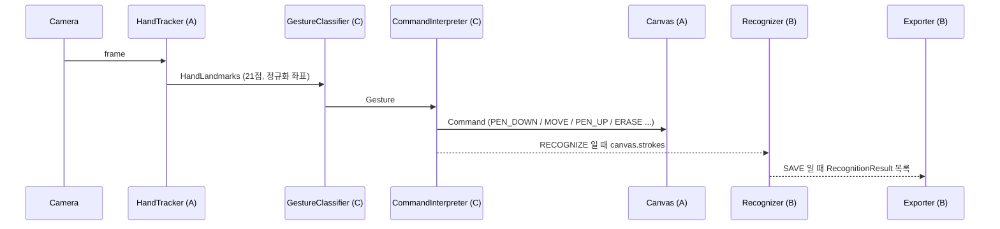

# 아키텍처

## 파이프라인

매 프레임마다 아래 순서로 처리합니다. 인식과 저장은 해당 커맨드가 나올 때만 실행합니다.

조립과 루프는 `app.py` 의 `Pipeline` 이 담당합니다.
`Pipeline` 은 `core/interfaces.py` 의 Protocol에만 의존하므로,
`tests/test_pipeline.py` 처럼 가짜 객체를 끼워 카메라 없이 통합 테스트할 수 있습니다.

## 모듈 간 계약

| 인터페이스 | 입력 | 출력 | 담당 | 구현 |
|---|---|---|---|---|
| `HandTracker` | BGR 프레임 | `HandLandmarks \| None` | A | `tracking/hand_tracker.py` |
| `PointFilter` | `Point` (픽셀) | `Point` (픽셀) | A | `tracking/smoothing.py` |
| `GestureClassifier` | `HandLandmarks` | `Gesture` | C | `gestures/classifier.py` |
| `CommandInterpreter` | `Gesture`, 검지 끝 `Point` | `list[Command]` | C | `gestures/commands.py` |
| `Canvas` | `Command` | `strokes` 갱신 | A | `canvas/air_canvas.py` |
| `Renderer` | 프레임, 획, 인식 결과 | 프레임 | A | `canvas/renderer.py` |
| `Recognizer` | `list[Stroke]` | `list[RecognitionResult]` | B | `recognition/shape.py`, `ocr.py` |
| `Exporter` | 인식 결과, 경로 | 저장된 경로 | B | `export/svg.py`, `mermaid.py` |

### 좌표 규칙
- `HandLandmarks.points` 만 정규화 좌표(0~1)입니다. MediaPipe 출력을 그대로 담습니다.
- 그 외 모든 `Point` (획, 커맨드, bbox)는 **화면 픽셀 좌표**입니다. 변환은 `Pipeline` 이 합니다.
- 색상은 OpenCV 기준 **BGR** 입니다.

## 설계 결정

### 도형 인식은 OpenCV, 글씨 인식만 Hugging Face
사각형/원 같은 단순 도형은 `cv2.approxPolyDP` 와 원형도 계산만으로 충분히 정확하고,
모델 추론보다 수백 배 빠릅니다. 데모의 핵심인 "그리자마자 깨끗한 도형으로 변환"을
실시간으로 보여주기 위해 도형은 기하 연산으로 처리하고,
무거운 Hugging Face 모델은 손글씨 OCR에만 씁니다.
`CompositeRecognizer` 가 도형으로 인식되지 않은 획만 OCR로 넘깁니다.

### OCR 의존성은 선택 설치
`torch` + `transformers` 는 수 GB입니다. 팀원 A와 C는 설치하지 않아도 개발할 수 있게
`pip install -e ".[ocr]"` 로 분리했고, 설치되지 않은 환경에서는 OCR이 자동으로 꺼집니다.

### 제스처는 '판정'과 '해석'을 분리
`GestureClassifier` 는 한 프레임만 보고 손 모양을 판정하고,
`CommandInterpreter` 는 프레임 흐름을 보고 debounce와 상태 전환을 처리합니다.
판정 로직과 상태 머신을 따로 테스트할 수 있습니다.
